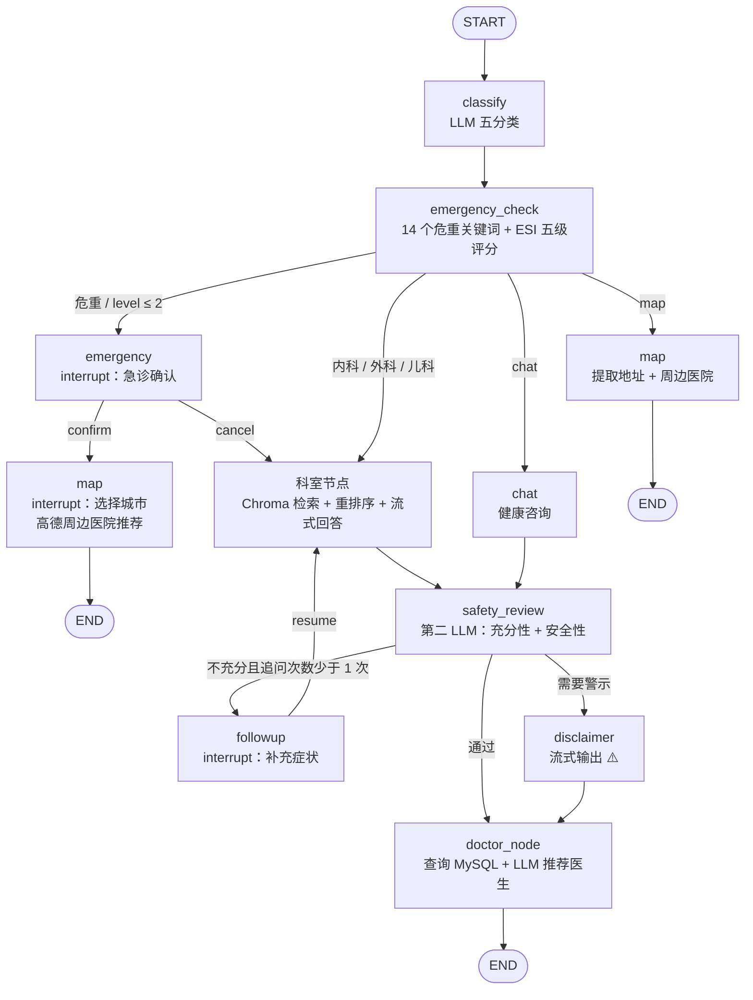

# 健康分诊助手 · Medical Triage Agent

基于 **FastAPI + LangGraph + RAG** 的医疗智能分诊对话系统。用户在前端描述症状后，系统依次完成意图分类、危重检测、ESI 五级分诊、科室知识库问诊、安全审查和医生推荐；支持急诊中断导航、症状不足多轮追问和流式输出。

> ⚠️ **免责声明**：本项目仅用于技术学习与演示，输出内容不能替代专业医生的诊断与治疗，请勿用于真实临床决策。

## 功能特性

- **五分类意图识别**：内科 / 外科 / 儿科 / 健康咨询 / 地址查询
- **规则 + LLM 双层分诊**：14 个危重关键词硬拦截 + ESI 五级评分，降低危重漏判
- **三科室 RAG**：Chroma 向量检索 + `bge-reranker-large` 重排序，内置 591 个疾病条目
- **安全审查护栏**：第二 LLM 同时判断“症状是否充分”与“回复是否安全”，必要时追加 ⚠️ 警示
- **急诊中断导航**：识别危重后暂停对话，用户确认后选择城市，调用高德 API 推荐周边医院
- **症状追问**：信息不足时中断对话追问补充（最多 1 次），补充后重新进入科室节点
- **智能医生推荐**：按分诊科室查询 MySQL 医生表，由 LLM 推荐最合适的一位
- **流式输出**：按节点白名单透传 LLM 流式内容，过滤结构化输出的中间 JSON
- **多轮会话隔离**：基于 LangGraph `MemorySaver` + `thread_id`
- **H5 / App 跨端前端**：UniApp + Vue3，H5 端支持真实流式渲染

## 系统架构

### 分诊流程



### 节点职责

| 节点 | 职责 | 流式输出 |
|---|---|---|
| `classify` | LLM 结构化输出五分类结果 | ❌ |
| `emergency_check` | 关键词硬拦截 + ESI 1–5 级评分 | ❌ |
| `emergency` | 中断等待用户确认，确认后给出行动指引并跳转地图 | ✅ 部分 |
| `internal_medicine` / `surgery` / `pediatrics` | RAG 检索 + 结合分诊级别生成回答 | ✅ |
| `chat` | 健康咨询，直接基于历史消息对话 | ✅ |
| `map` | 急诊场景选择城市；非急诊场景提取地址，调用高德搜索医院 | ✅ |
| `safety_review` | 第二 LLM：判断症状充分性与回复安全性 | ❌ |
| `followup` | 中断等待用户补充症状，resume 后回到科室节点 | ❌ |
| `disclaimer` | 审查发现问题时流式输出安全警示 | ✅ |
| `doctor_node` | 查询 MySQL 同科室医生并由 LLM 推荐 | ✅ |

条件路由只有两处：

- `route_after_triage`：`is_emergency` 或 `triage_level <= 2` → 急诊分支，否则按分类进入科室 / chat / map
- `route_after_review`：症状不充分 → 追问；需要警示 → disclaimer；否则 → 医生推荐

## 技术栈

| 层次 | 技术 |
|---|---|
| 后端框架 | Python 3.12、FastAPI、Uvicorn |
| Agent 编排 | LangGraph（`StateGraph` + `interrupt/resume` + `MemorySaver`） |
| LLM | 通义千问（DashScope OpenAI 兼容接口，`langchain-openai`） |
| RAG | Chroma 服务端、Ollama `nomic-embed-text`、`bge-reranker-large` CrossEncoder |
| 数据层 | MySQL 8 + SQLAlchemy + PyMySQL |
| 地图服务 | 高德开放平台 Web 服务 API |
| 前端 | UniApp + Vue3（HBuilderX），H5 使用 Fetch ReadableStream 消费流式响应 |

## 目录结构

```text
pr3/
├── backend/
│   ├── main.py                     # FastAPI 入口（端口 8000）
│   ├── .env.example                # 环境变量模板
│   ├── requirements.txt            # Python 依赖
│   ├── knowledge_base/             # 三科室 Markdown 知识库
│   │   ├── internal_medicine.md    # 内科 263 条
│   │   ├── surgery.md              # 外科 142 条
│   │   └── pediatrics.md           # 儿科 186 条
│   ├── models/
│   │   ├── llm.py                  # 千问 LLM 初始化
│   │   └── chroma.py               # Chroma 建库与索引
│   ├── routers/
│   │   └── chat_router.py          # /api/chat 流式接口
│   ├── tools/
│   │   └── nearby_search_tool.py   # 高德周边医院搜索
│   ├── triage_agent/
│   │   ├── graph.py                # LangGraph 状态机核心
│   │   └── knowledge.py            # 向量检索 + 重排序
│   └── utils/
│       ├── env_util.py             # 环境变量读取
│       └── logger.py               # 日志
├── frontend/
│   ├── pages/index/index.vue       # 对话主页面
│   ├── pages/index/regions.js      # 省市数据
│   ├── manifest.json               # UniApp 配置（H5 devServer 代理）
│   └── pages.json
├── README.md
└── 项目文档.md                     # 架构决策、踩坑记录与解决方案
```

## 快速开始

### 1. 环境要求

- Python 3.12+
- MySQL 8.x
- [Chroma](https://www.trychroma.com/)（以服务端模式运行，默认端口 `8081`）
- [Ollama](https://ollama.com/)（本地 embedding 模型）
- HBuilderX（前端 H5 调试）

### 2. 配置环境变量

```bash
cd backend
cp .env.example .env        # Windows PowerShell: Copy-Item .env.example .env
```

按实际情况填写 `.env`。**请勿把 `.env` 提交到仓库**。

### 3. 安装后端依赖

```bash
# 在 backend 目录下
pip install -r requirements.txt
```

### 4. 启动依赖服务

**MySQL**：创建数据库、医生表并插入测试数据（SQL 见下方[数据库](#数据库)）。

**Chroma**（启动独立向量库服务）：

```bash
chroma run --path ./chroma_data --port 8081
```

**Ollama**：

```bash
ollama serve
ollama pull nomic-embed-text
```

**重排序模型** `BAAI/bge-reranker-large`：

```bash
huggingface-cli download BAAI/bge-reranker-large --cache-dir D:/hf_cache/hub
```

并确保 `.env` 中 `HF_HOME=D:/hf_cache`。代码在 `backend/triage_agent/knowledge.py` 中写死了模型快照路径：

```python
_RERANKER_MODEL_PATH = os.path.join(
    hf_home, "hub", "models--BAAI--bge-reranker-large",
    "snapshots", "55611d7bca2a7133960a6d3b71e083071bbfc312",
)
```

若本地缓存目录的 snapshot 哈希不同，请将该常量改为实际路径（或直接改为模型名 `BAAI/bge-reranker-large`）。

### 5. 启动后端

```bash
# 在 backend 目录下
python main.py
```

服务运行在 `http://localhost:8000`，访问 `/` 可做健康检查。首次提问时，后端会自动把对应科室的 Markdown 知识库切分并索引到 Chroma。

### 6. 启动前端

使用 HBuilderX 导入 `frontend/` 目录，选择 **运行 → 运行到浏览器**。H5 devServer 配置在 `frontend/manifest.json`：

- 前端地址：`http://127.0.0.1:5342`
- `/api` 代理到：`http://localhost:8000`

> 前端没有独立的 `package.json`，依赖 HBuilderX 内置编译。H5 端使用 `fetch` + `ReadableStream` 实现真实流式输出；App / 小程序端会退化为 `uni.request` 一次性返回，体验不等同于 H5，建议优先使用浏览器调试。

### 7. 快速体验

| 输入 | 预期行为 |
|---|---|
| `我头疼发烧三天了` | 内科 RAG 回答 + 医生推荐 |
| `摔伤了腿伤口很深` | 外科 RAG 回答 + 医生推荐 |
| `孩子一直咳嗽` | 儿科 RAG 回答 + 医生推荐 |
| `感冒多喝水有用吗` | 健康咨询，不推荐医生 |
| `我突然呼吸困难` | 触发急诊中断卡片 |
| `我不舒服` | 可能触发症状追问卡片 |

## 环境变量说明

| 变量 | 必填 | 默认值 | 说明 |
|---|---|---|---|
| `QWEN_MODEL_NAME` | ✅ | — | 通义千问模型名（按服务商提供的名称填写） |
| `QWEN_API_KEY` | ✅ | — | DashScope / 兼容服务 API Key |
| `QWEN_BASE_URL` | ✅ | — | OpenAI 兼容接口地址 |
| `GAODE_API_KEY` | ✅ | — | 高德开放平台 Web 服务 Key |
| `GAODE_NEARBY_URL` | ✅ | — | 周边搜索接口地址 |
| `GAODE_LOCATION_URL` | ✅ | — | 关键字搜索接口地址 |
| `EMBEDDINGS_MODEL_NAME` | ❌ | `nomic-embed-text` | Ollama embedding 模型名 |
| `CHROMA_HOST` | ❌ | `localhost` | Chroma 服务地址 |
| `CHROMA_PORT` | ❌ | `8081` | Chroma 服务端口 |
| `HF_HOME` | ❌ | 空 | HuggingFace 缓存根目录，用于定位 reranker |
| `CONNECTION_STRING` | ✅ | — | SQLAlchemy MySQL 连接串 |

## API 说明

后端统一前缀 `/api`，流式响应为**逐行 JSON（NDJSON）**，每行一条消息。

### 发起对话

```http
GET /api/chat/stream?question=我头疼发烧三天了&thread_id=demo-1
```

| 参数 | 必填 | 说明 |
|---|---|---|
| `question` | ✅ | 用户输入 |
| `thread_id` | ❌ | 会话标识；不传则后端生成 UUID。多轮对话请自行传入并复用同一 ID |

### 恢复中断

```http
POST /api/chat/resume
Content-Type: application/json

{
  "thread_id": "demo-1",
  "resume_value": "confirm"
}
```

`resume_value` 的取值取决于中断类型：

| 中断类型 `type` | 可选值 |
|---|---|
| `emergency` | `confirm`（需要紧急帮助）/ `cancel`（暂不需要） |
| `address_select` | 城市名，如 `北京` |
| `followup` | 用户补充的症状文本 |

### 响应消息格式

```json
{"c": "文本片段"}
{"interrupt": true, "thread_id": "demo-1", "type": "emergency", "payload": {"type": "emergency", "advice": "检测到您可能存在危重症状，建议立即就医或拨打120。"}}
{"interrupt": true, "thread_id": "demo-1", "type": "address_select", "payload": {"prompt": "请选择您所在的城市，我会为您推荐附近的医院"}}
{"interrupt": true, "thread_id": "demo-1", "type": "followup", "payload": {"prompt": "为更准确判断，请补充更多的症状细节：..."}}
{"err": "错误信息"}
```

### 调试示例

```bash
# 发起对话（-N 关闭缓冲，便于观察流式输出）
curl -N -G "http://localhost:8000/api/chat/stream" \
  --data-urlencode "question=我突然呼吸困难" \
  --data-urlencode "thread_id=demo-1"

# 收到 interrupt 后恢复对话
curl -N -X POST "http://localhost:8000/api/chat/resume" \
  -H "Content-Type: application/json" \
  -d '{"thread_id":"demo-1","resume_value":"confirm"}'
```

## 数据库

`doctor_node` 会执行：

```sql
SELECT name, gender, age, practice_years, intro
FROM doctors WHERE department = :dept
```

其中 `department` 存的是分类键（`internal_medicine` / `surgery` / `pediatrics`），**不是中文科室名**。

```sql
CREATE DATABASE IF NOT EXISTS doctor_db DEFAULT CHARSET utf8mb4;
USE doctor_db;

CREATE TABLE IF NOT EXISTS doctors (
    id             INT AUTO_INCREMENT PRIMARY KEY,
    name           VARCHAR(50)  NOT NULL,
    gender         VARCHAR(10)  NOT NULL,
    age            INT          NOT NULL,
    practice_years INT          NOT NULL,
    intro          TEXT         NOT NULL,
    department     VARCHAR(50)  NOT NULL,
    INDEX idx_department (department)
) ENGINE=InnoDB DEFAULT CHARSET=utf8mb4;

INSERT INTO doctors (name, gender, age, practice_years, intro, department) VALUES
('张建国', '男', 52, 28, '擅长高血压、冠心病、糖尿病等慢性病诊治', 'internal_medicine'),
('李慧敏', '女', 45, 20, '擅长普通外科、创伤清创与术后康复', 'surgery'),
('王雪梅', '女', 40, 16, '擅长小儿呼吸系统疾病、发热与消化道疾病', 'pediatrics');
```

## 关键设计

- **规则硬墙 + LLM 软尺**：14 个危重关键词先做硬拦截，ESI 五级评分再补捞关键词未覆盖的危重情况，规则是安全底线。
- **生成与审查分离**：`safety_review` 不流式（攒齐全文再审查），只有需要警示时由 `disclaimer` 流式追加 ⚠️，避免结构化 JSON 污染用户可见流。
- **流式节点白名单**：`_STREAM_NODES` 只放行面向用户的节点，过滤 `classify`、`emergency_check`、`safety_review` 的中间输出。
- **追问防死循环**：`followup_count` 限制最多追问 1 次，到达上限后直接放行。
- **同源代理规避 CORS**：后端不挂 CORS 中间件，前端通过 Vite devServer 将 `/api` 代理到 `:8000`，流式响应不会被缓冲。

更完整的架构决策、踩坑记录与解决方案见 [项目文档.md](./项目文档.md)。

## 常见问题

**Q：Chroma 连接失败？**
先确认 `chroma run --path ./chroma_data --port 8081` 已启动，且 `.env` 中 `CHROMA_HOST` / `CHROMA_PORT` 一致。

**Q：启动时报 Ollama embedding 模型不存在？**
执行 `ollama pull nomic-embed-text`，或把 `EMBEDDINGS_MODEL_NAME` 改成已下载的模型。

**Q：报 reranker 模型路径不存在？**
检查 `HF_HOME` 与实际缓存目录，并确认 `backend/triage_agent/knowledge.py` 中 `_RERANKER_MODEL_PATH` 的 snapshot 哈希与本地一致。

**Q：急诊后选城市推荐医院报错？**
检查 `GAODE_API_KEY` 是否有效、是否开通 Web 服务，以及当日配额是否用尽。

**Q：resume 时报 `'Interrupt' object has no attribute 'get'`？**
同一轮中断/恢复必须使用同一个 `thread_id`。前端已把中断返回的 `thread_id` 保存在 `interruptThreadId` 中。

**Q：前端请求 404 或跨域失败？**
H5 必须通过 devServer 访问（`http://127.0.0.1:5342`），直接打开 `index.html` 或修改端口都会导致 `/api` 代理失效。

**Q：为什么没有推荐医生？**
`chat` 健康咨询不会推荐医生；科室查询无结果时也会跳过，检查 `doctors.department` 是否与分类键一致。

**Q：重启后端后历史对话丢失？**
会话状态保存在进程内存（`MemorySaver`），重启即清空；生产环境可替换为持久化 checkpointer。

## 相关文档

- [项目文档.md](./项目文档.md)：架构选型、技术决策、踩坑难点与解决方案
- [backend/knowledge_base](./backend/knowledge_base)：内科 / 外科 / 儿科知识库源文件

## License

本项目仅用于学习与演示，未声明开源许可证。如需使用其中内容，请联系仓库作者。
